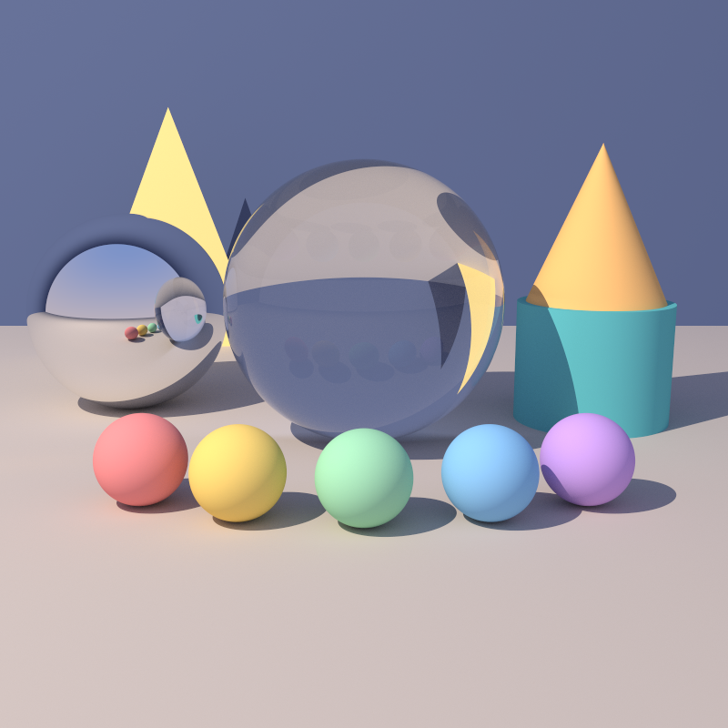

# Raytracer

A progressive path tracer written in C++98 with SDL2. It renders a scene of spheres, planes, triangles, rectangles, cylinders and cones with diffuse, mirror and glass materials. The image refines with every frame, and you can move the camera and objects while it renders.



## Features

- **Path tracing**: up to 5 bounces per path, with cosine-weighted diffuse scattering and direct light sampling through shadow rays
- **Materials**: diffuse (Lambertian), perfect mirror, and glass (Snell refraction with Schlick reflectance)
- **Shapes**: sphere, infinite plane, triangle (Möller–Trumbore), parallelogram, closed cylinder, closed cone
- **Progressive rendering**: one sample per pixel per frame, averaged over time, with sub-pixel jitter for anti-aliasing
- **Multithreading**: one worker per CPU core; rows are handed out through a shared atomic counter
- **Interactive**: rotate, move and zoom the camera, and select and move objects; the image restarts on every change

## Requirements

- A C++ compiler (g++ or clang++)
- SDL2 development package (provides headers, the library and `sdl2-config`)
- make

| Platform | Install SDL2 |
|---|---|
| Ubuntu / Debian | `sudo apt install libsdl2-dev` |
| Fedora | `sudo dnf install SDL2-devel` |
| macOS | `brew install sdl2` |

## Build and run

```bash
git clone https://github.com/mohammedhrima/Raytracer.git
cd Raytracer
make
./exec
```

| Command | Effect |
|---|---|
| `make` | Build `exec` |
| `make clean` | Remove `objects/` and `exec` |
| `make re` | Clean and rebuild |

Compiler flags: `-std=c++98 -O2 -Wall -Wextra -Werror -pthread`, plus `sdl2-config --cflags --libs`.

The window title shows the time spent on the last frame and the number of samples accumulated so far.

## Controls

| Input | Action |
|---|---|
| Left mouse drag | Rotate the camera |
| Mouse wheel, `+` / `-`, Page Up / Page Down | Move forward / backward along the view direction |
| Arrow keys | Move the camera up, down, left, right |
| `R` | Reset the camera |
| `0`–`9` | Select an object (insertion order in `addDefaultObjects()`) |
| Numpad `8` / `2` | Move the selected object up / down |
| Numpad `4` / `6` | Move the selected object left / right |
| Numpad `5` / `0` | Move the selected object away / closer |
| `Esc` | Quit |

## Project structure

```
Raytracer/
├── Makefile
└── src/
    ├── main.cpp              Window, scene and camera setup, main loop, input
    ├── math/
    │   ├── Vec3.hpp          Vec3, Ray, vector math, reflect / refract
    │   └── Random.hpp        Per-thread PCG random number generator
    ├── scene/
    │   ├── Shape.hpp/.cpp    Material, Hit, and every shape's intersection code
    │   └── Scene.hpp/.cpp    Shape list, light, closest-hit and shadow queries, default scene
    └── render/
        ├── Camera.hpp/.cpp   Pinhole camera
        ├── Renderer.hpp/.cpp Path tracer and worker threads
        └── Window.hpp/.cpp   SDL window and streaming texture
```

## How it works

1. **Camera rays.** For each pixel, `Camera::rayFor` shoots a ray from the camera through a random point inside the pixel.
2. **Intersection.** `Scene::closestHit` tests every shape and keeps the nearest hit. Each shape returns the hit distance, point, and a normal that faces the incoming ray.
3. **Shading.** `Renderer::trace` follows the path:
   - **Diffuse**: adds the light from the point light if a shadow ray reaches it, then bounces in a random cosine-weighted direction.
   - **Mirror**: reflects the ray.
   - **Glass**: reflects or refracts, picked at random using Schlick's approximation. Total internal reflection is handled.
   - **Miss**: adds the sky color.
4. **Accumulation.** Each sample is added to a per-pixel sum. The displayed color is the average, gamma-corrected (gamma 2).

## Customization

- **Scene**: edit `Scene::addDefaultObjects()` in `src/scene/Scene.cpp` to add or change shapes and materials, and change the light in the `Scene` constructor.
- **Camera**: edit the start position and field of view in `src/render/Camera.cpp`.
- **Quality and speed**: `MAX_BOUNCES` and the sky colors are at the top of `src/render/Renderer.cpp`. The window size is set in `src/main.cpp`.

## Troubleshooting

- **`sdl2-config: not found` or `SDL.h: No such file or directory`**: the SDL2 development package is missing. Install it as shown in [Requirements](#requirements).
- **Image is noisy**: this is expected right after a change. Leave the camera still and the noise fades as samples accumulate.

## References

- [Ray Tracing in One Weekend](https://raytracing.github.io/)
- [Scratchapixel](https://www.scratchapixel.com/)
- [SDL2 documentation](https://wiki.libsdl.org/)
